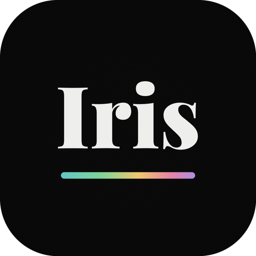
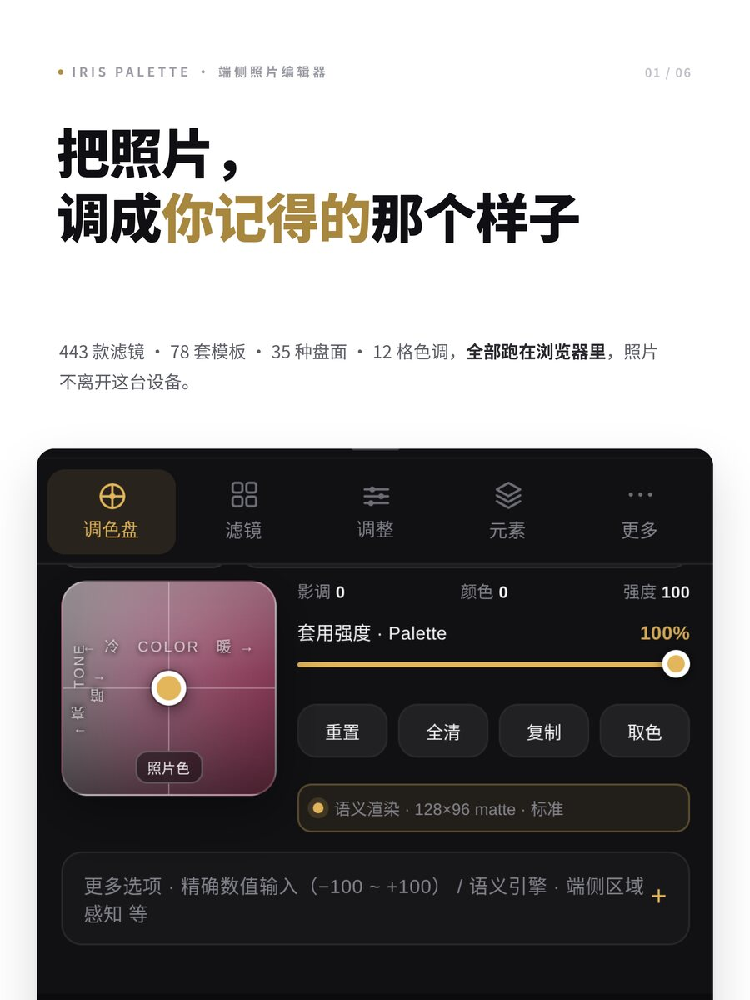
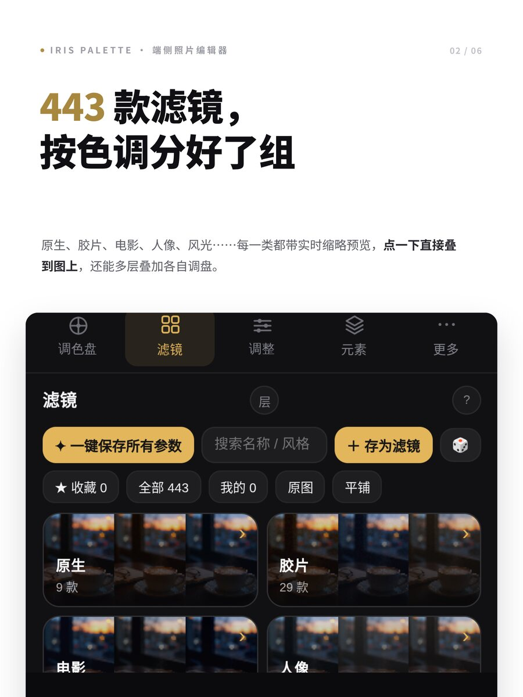
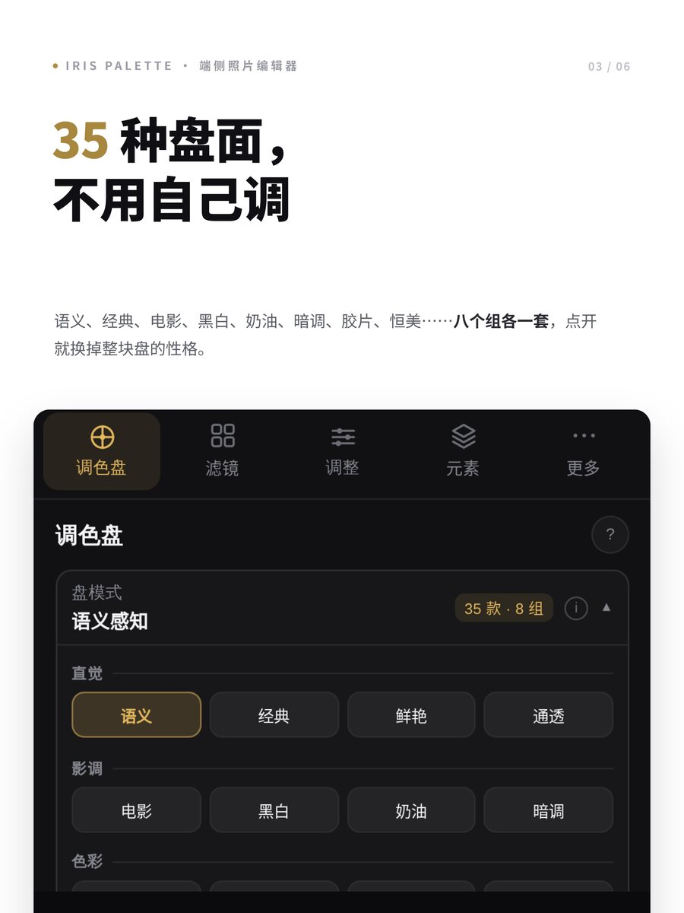
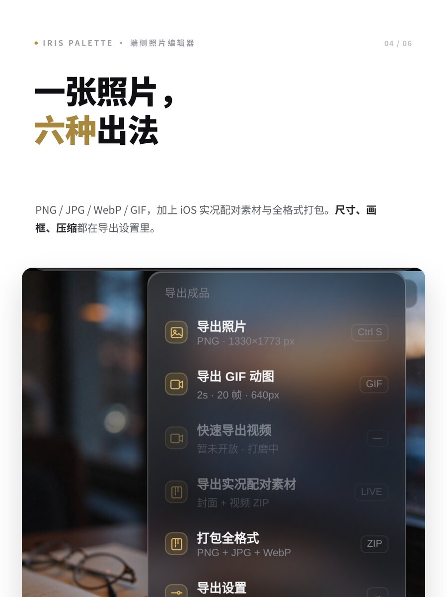
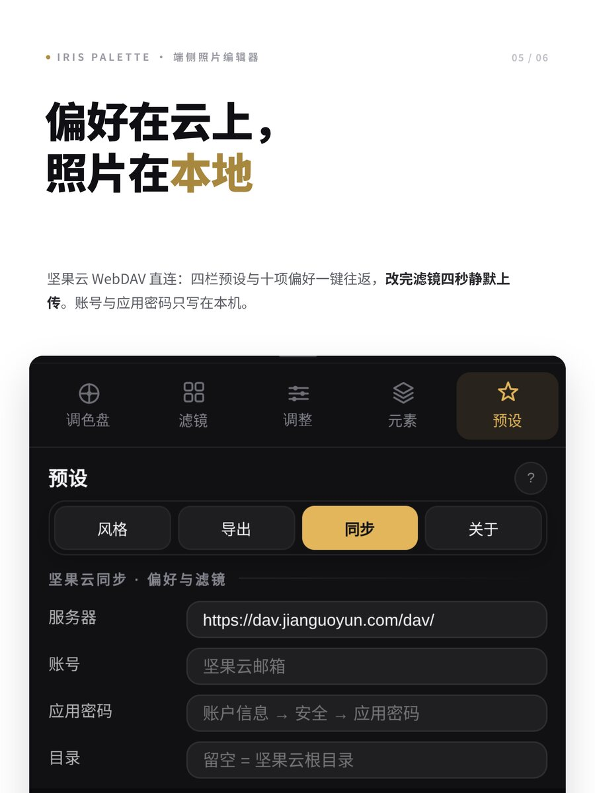
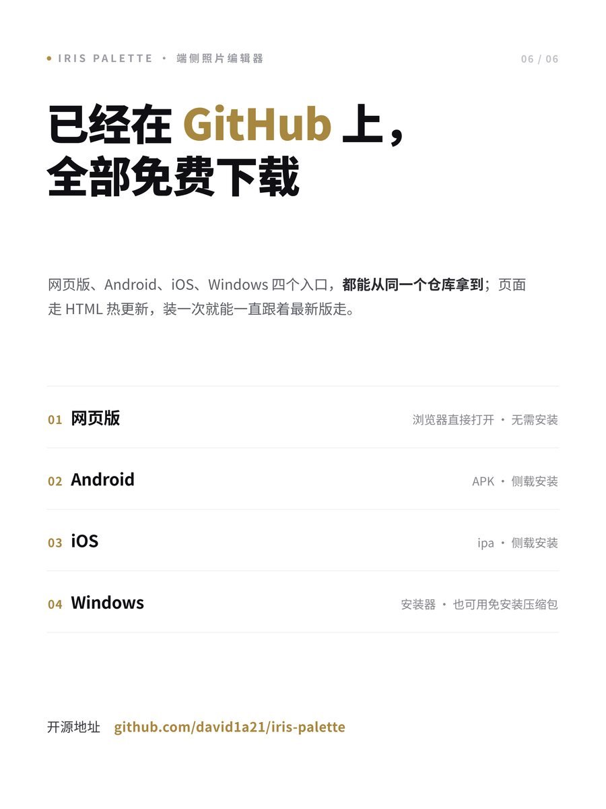

<div align="center">



# Iris 调色盘 · Iris Palette

**把色彩决策，压成一块可以拖动的盘。**

一个单文件网页级的照片编辑器，装进 Android / iOS / Windows / Linux / macOS 的壳里。<br>
页面自包含、零外部请求，照片读完就留在你自己的设备上。

<br>


<br><br>

[网页版直接开](https://david1a21.github.io/iris-palette-web/)　·　[Cloudflare 镜像](https://irisplus.pages.dev/)　·　[下载安装包](https://github.com/david1a21/iris-palette/releases)　·　[宣传图](docs/showcase)

<br>

<sub>443 款滤镜 · 78 套快捷模板 · 35 款盘面 · 12 格色调 · EXIF 元数据 · 全部跑在浏览器里</sub>

</div>

<br>

<table align="center">
<tr>
<td align="center"><br><sub>一块盘定色光</sub></td>
<td align="center"><br><sub>443 款滤镜分组</sub></td>
<td align="center"><br><sub>35 款盘面成组</sub></td>
</tr>
<tr>
<td align="center"><br><sub>一张照片六种出法</sub></td>
<td align="center"><br><sub>偏好上云 · 照片留在本地</sub></td>
<td align="center"><br><sub>全平台免费下载</sub></td>
</tr>
</table>

<div align="center"><sub>以上均为真实界面截图与精确排版渲染，原图在 <a href="docs/showcase">docs/showcase</a>（3:4，2 倍像素）。</sub></div>

---

## 它是什么

不是「再给你一大堆滤镜预设」，而是一套**调色盘式的色彩决策模型**。

传统做法是把饱和度拉高、把某个预设套上去，结果常常是「颜色更艳了，但看着脏」。Iris 走另一条路：**色相统一 + 冷暖染色 + 影调重塑 + 柔和保护**。你在盘里放一个点，横轴决定冷暖走向、纵轴决定影调重塑、半径决定染色强度，再叠一层皮肤权重保护 —— 白点落在哪都能得到**明显但协调**的成片，而不是把皮肤染成橘红、把天空压成塑料蓝。

它也不只是「能调色」：曲线、分色、局部蒙版、裁剪、文字、模板、命令面板、六种导出、坚果云同步都在里面，而且全部跑在浏览器里 —— 没有后端、没有账号、不上传照片。

| 维度 | 事实 |
|---|---|
| 形态 | 单文件 HTML，`web/index.html`，1,427,706 字节（约 1.36 MB） |
| 渲染 | WebGL 实时预览 + Canvas 2D 叠加层 |
| 联网 | **零外部依赖**：无 CDN、无字体服务、无统计脚本，断网可用 |
| 隐私 | 图片不离开设备；localStorage / IndexedDB 只存你自己的设置 |
| 平台 | 浏览器直接跑；另有 Android / iOS / Windows / Linux / macOS 原生壳 |

## 一块盘怎么工作

| 轴 | 管什么 |
|---|---|
| 横轴 | 冷暖走向，负值偏青蓝、正值偏橙黄 |
| 纵轴 | 影调重塑强度，往上提亮、往下压暗 |
| 半径 | 染色强度，越靠外越狠 |
| 右侧 12 格 | 高光 / 中间调 / 阴影 × 红橙黄绿青蓝紫品红，要单独动某一族颜色时用 |
| 套用强度 | 整体回拉，100% 是全量、0% 等于没调 |

两条刻意的设计：

1. **双向同步** —— 盘上的光点会实时反映到数值，数值框改数也会带动盘上光点，不存在「预设值 / 当前值」两套真相。
2. **随时退回零位** —— 双击参数归零、双击盘心回到原始色调、长按「对比」看原图，不需要先记住原样再手动复原。

## 能做什么

<table>
<tr><td width="120"><b>调色盘</b></td><td>二维盘调色（横轴冷暖 / 纵轴影调 / 半径强度）· 12 格独立色调 · 套用强度 · 多盘叠加 · 取色 · 语义渲染（128×96 matte，端侧区域感知）</td></tr>
<tr><td><b>滤镜</b></td><td>443 款，按原生 / 胶片 / 电影 / 人像 / 风光等分组，每款带实时缩略预览 · 收藏、搜索、分层叠加 · 一键保存所有参数 · 存为滤镜</td></tr>
<tr><td><b>盘面模式</b></td><td>35 款、8 组（语义 / 经典 / 影调 / 色彩…），点开即换整块盘的性格，不用自己配</td></tr>
<tr><td><b>调整</b></td><td>曝光 · 对比 · 高光 · 阴影 · 黑白场 · 清晰度 · 纹理 · 白平衡（色温 / 色调）· HSL 分通道 · RGB 与分通道曲线 · 三色轮分级</td></tr>
<tr><td><b>元素</b></td><td>裁剪与比例、旋转校正、网格辅助；文字与贴纸叠加，位置可拖</td></tr>
<tr><td><b>效率</b></td><td>命令面板一跳到位 · 全局快捷键 · 自动保存与编辑历史 · 导入进度条 · 最近使用与导出记录 · 模板库（78 套快捷模板）</td></tr>
<tr><td><b>说明书</b></td><td>内置 25 章图文说明书 + 技术实现独立页 + 页面中心（全部 22 页），带目录与搜索</td></tr>
<tr><td><b>对比</b></td><td>长按看原图 · 滑动分割线对比（一条线、两枚标签、一个数值气泡，单击画面即可落点）· 沉浸大图</td></tr>
<tr><td><b>元数据</b></td><td>照片 EXIF 独立页：相机 / 镜头 / 光圈 / 快门 / ISO / 焦距 / 拍摄时间 / GPS，只读本机文件前 4 MB，HEIC·HEIF 尽力解析，不联网</td></tr>
<tr><td><b>同步</b></td><td>坚果云 WebDAV：四栏预设 + 10 项偏好一键往返，账号与应用密码只写在本机</td></tr>
</table>

## 导出六种

打开导出菜单，六个入口，对应六种交付物：

| 入口 | 产出 | 状态 |
|---|---|---|
| 导出照片 | PNG / JPG / WebP，带尺寸、画框、压缩设置 | 可用 |
| 导出 GIF 动图 | GIF，默认 2 秒 / 20 帧、宽度可选（默认 640） | 可用 |
| 导出实况配对素材 | 封面 + 视频 ZIP，用于在 iOS 侧合成实况照片 | 可用 |
| 打包全格式 | PNG + JPG + WebP 一次打包 | 可用 |
| 导出设置 | 统一配置尺寸、画框、压缩，作用于以上各项 | 可用 |
| 快速导出视频 | 视频源直出 | 打磨中，入口置灰 |

## 坚果云同步

> 横跨设备的是**偏好**，不是照片。

1. 打开「预设 → 同步」，服务器填 `https://dav.jianguoyun.com/dav/`
2. 账号填坚果云注册邮箱，应用密码在「账户信息 → 安全 → 应用密码」生成（不是登录密码）
3. 目录留空 = 坚果云根目录。四栏预设与 10 项偏好一键往返，改完滤镜几秒后静默上传

两点必须说明：

- **账号与应用密码只存在你自己机器上**，请求直达坚果云，不经过任何中间服务器。
- **网页版受 CORS 限制无法直连**，直连会被拦死；这三端壳（Android / 桌面 / iOS）内置了 WebDAV 代理，所以在壳里能同步、在浏览器里不行。

## 下载安装

> 页面只有一份，五端同源；安装包差异只在壳。所有包都在 [Releases](https://github.com/david1a21/iris-palette/releases)。

| 平台 | 文件 | 页面版本 | 大小 | 拿哪个 Release |
|---|---|---|---|---|
| 网页版 | 浏览器直接打开 | **1.0.41** | — | 无需下载 |
| Windows x64 | `Iris-Palette-Windows-x64-1.0.41-Setup.exe` | **1.0.41** | 79.3 MB | `v1.0.41` |
| iOS | `Iris-Palette-iOS-1.0.41.ipa` | **1.0.41**（build 46） | 999 KB | `v1.0.41` |
| Android | `Iris_1.0.44.apk` | **1.0.41**（壳 1.0.44） | 853 KB | `v1.0.44` |
| macOS arm64 | `Iris-Palette-macOS-arm64-1.0.33.zip` | 1.0.33 → 热更新至 1.0.41 | 97.4 MB | `v1.0.33` |
| macOS x64 | `Iris-Palette-macOS-x64-1.0.33.zip` | 1.0.33 → 热更新至 1.0.41 | 103.5 MB | `v1.0.33` |
| Linux x64 | `Iris-Palette-Linux-x64-1.0.33.tar.gz` | 1.0.33 → 热更新至 1.0.41 | 107.0 MB | `v1.0.33` |

壳版本号落后不等于功能落后：装 1.0.33 的包，启动后页面会自动热更新到 1.0.41（见下一节）；Android 另有 1.0.44 的壳修复包（相册落点按厂商分流 + 导出不再被时序闸门吞掉），内嵌 1.0.41 页面、可直接覆盖安装。1.0.34–1.0.38 只走了热更新、没有单独建 Release，1.0.39 起才补建，所以列表里会看到版本跳档。

<details>
<summary><b>各平台安装细节</b>（点开）</summary>

<br>

**Android** — 通用 arm64，v2 + v3 签名。安装需允许「未知来源」。首次打开申请相册写入权限（导出后自动存图），拒绝也能用，只是改走系统分享。系统文件选择器会按 MIME 过滤 `.cube` / `.heic`，壳里已放宽。

**iOS** — 未签名 ipa，arm64，最低 iOS 16.0。三条路：自签工具（Sideloadly / AltStore / 爱思助手）重签；越狱设备用 TrollStore / AppSync；或者 Sidestore + LiveContainer（免费续签，推荐）。导出走原生存档，规避 iOS 上 blob 下载失败。

**Windows** — 安装器双击即装；首次运行 SmartScreen 会提示，点「更多信息 → 仍要运行」。也可用 `v1.0.33` 的免安装 zip，解压后运行 `Iris 调色盘.exe`。

**macOS** — arm64 与 x64 **不通用**，Intel 机器装 arm64 包会报「应用已损坏 / 版本要求过高」这类含糊错误，那是架构不匹配。被 Gatekeeper 拦下时：

```bash
xattr -dr com.apple.quarantine "/Applications/Iris 调色盘.app"
```

**Linux** —

```bash
tar -xzf Iris-Palette-Linux-x64-1.0.33.tar.gz
chmod +x "Iris 调色盘" && ./"Iris 调色盘"
```

</details>

## 热更新

页面和壳解耦之后，迭代就不用等商店审核、也不用重装：

```
壳启动 → 拉 web/hot-update.json → 比对 sha256 → 不同则下载新页面
      → 落到本地 → 提示你应用 → 下次启动直接跑新版
```

`hot-update.json` 是这个样子，文件本身就在仓库里：

```json
{
  "version": "1.0.41",
  "sha256": "dce611e30695052ea3a2e75fcb71fec54fe8784ac143f4717aea264d6e23e1b4",
  "size": 1427706,
  "url": "https://raw.githubusercontent.com/david1a21/iris-palette/main/web/index.html"
}
```

校验不过就放弃本次更新、继续用当前页面 —— 宁可停在旧版，也不让半截文件把编辑器弄坏。

## 技术架构

```
┌────────────────────────────────────────────────┐
│  web/index.html（唯一源，1.33 MB）               │
│  ├─ CSS    内联，暗色 + 金色点缀                  │
│  ├─ JS     纯手写，无框架、无构建步骤              │
│  ├─ GLSL   WebGL 调色管线（plate / curve / …）   │
│  └─ 2D     叠加层、蒙版可视化、文字元素            │
└───────────────┬────────────────────────────────┘
                │ 同一份文件，四种外壳
     ┌──────────┼──────────┬──────────┐
     ▼          ▼          ▼          ▼
  Android   Electron      iOS      web/hot-update
  WebView   Win/Lin/Mac   WKWebView  页面热更新
  + shim    + shim        + shim
```

- **页面**：单文件、零依赖、离线可用；状态存 localStorage / IndexedDB
- **Android**：原生 WebView + `iris-shim.js`，导出改走 MediaStore，内置 WebDAV 代理
- **桌面**：Electron 31，主进程接管 `downloadBlob`，`preload` 只暴露最小接口，`contextIsolation` 开
- **iOS**：WKWebView + `iris-ios-shim.js`，导出分块（32 KB）交原生写文件并存相册，`CloudSync.swift` 做 WebDAV 代理

为什么坚持「页面一份、外壳多份」？因为**页面是唯一的事实来源**：任何平台都不许私自改页面逻辑，平台差异一律在外壳层消化。这样升级页面时，五端只需替换同一个 `index.html`，行为天然一致。

性能上预览走「视口优先」：画布只按实际显示尺寸采样，超大原图不会在你拖滑杆时被逐像素重算；导出时才以原始分辨率跑一次完整管线。所以手机上推盘是跟手的，导出要等一两秒。

## 仓库结构

```
iris-palette/
├── web/
│   ├── index.html              # 页面本体（唯一源，1,427,706 字节）
│   └── hot-update.json         # 热更新清单（版本 / sha256 / 大小 / 地址）
├── android/
│   ├── AndroidManifest.xml
│   ├── build.sh                # aapt2 + d8 + zipalign + apksigner
│   ├── java/com/iris/palette/  # 外壳：热更新、WebDAV 代理、相册写入
│   ├── res/                    # 图标、主题、字符串
│   └── assets/                 # index.html（同源）+ iris-shim.js
├── desktop/
│   ├── app/                    # main.js / preload.js / shim.js / assets/index.html
│   ├── scripts/
│   │   ├── build.js            # Electron 打包，版本号自动取自页面
│   │   ├── pack_release.py     # 产出 zip / tar.gz + checksums
│   │   ├── installer.nsi       # Windows NSIS 安装器中文化脚本
│   │   ├── make_setup.sh       # 出 Setup.exe
│   │   └── get_nsis.sh         # 一键拉 NSIS 工具链
│   ├── hot-update.json
│   └── build.sh
├── ios/
│   ├── Sources/                # Swift：AppDelegate / Shell / HotUpdate / CloudSync
│   ├── Resources/              # index.html（同源）+ iris-ios-shim.js + Info.plist
│   ├── build_ipa.sh            # 用 iphoneos SDK 直接 swiftc
│   └── .github/workflows/      # 云端 macos runner 出包
├── docs/
│   ├── showcase/               # 白底宣传套图 6 张（3:4）
│   ├── posters/                # 竖版 v01–v10 / 横版 h01–h10
│   └── screenshots/            # 界面截图与图标
├── version.json                # 发布版本戳
├── SHA256SUMS.txt              # 产物校验和
├── LICENSE · README.md
```

> 三处 `index.html` 是**同一份文件**，只是为了让各端独立构建时不必改脚本。改动请先改 `web/index.html`，再同步到壳里，之后更新 `hot-update.json` 的 sha256。

## 自己构建

<details>
<summary><b>Android</b> — 需要 JDK 17 + Android SDK（build-tools 34、platform android-34）</summary>

```bash
cd android
export JAVA_HOME=/path/to/jdk17
bash build.sh          # zip 分发的工程可能丢执行位，用 bash 调起最稳
```

产物在 `dist/`。签名默认用工程里的 keystore，**开源仓库未附私钥**，请自备并在 `build.sh` 里改路径。

</details>

<details>
<summary><b>桌面（Electron）</b> — 需要 Node 20+；出 Windows 安装器还要 NSIS</summary>

```bash
cd desktop
npm install
node scripts/build.js all      # win | linux | mac | macx64 | all
python3 scripts/pack_release.py
bash scripts/get_nsis.sh       # 首次出安装器前跑一次
bash scripts/make_setup.sh     # 产出 Setup.exe
```

版本号不用手改：`build.js` / `pack_release.py` / `make_setup.sh` 都从 `app/assets/index.html` 的 `IRIS_VERSION` 解析。缺 `makensis` 时只警告跳过安装器，不阻断整体构建。`mac` 出 arm64、`macx64` 出 Intel，两者必须分开。

</details>

<details>
<summary><b>iOS</b> — 需要 macOS + iphoneos SDK，或直接用 Actions</summary>

```bash
cd ios
bash build_ipa.sh              # 未签名 ipa
bash build_ipa.sh --adhoc      # 额外 ad-hoc 签名
```

推 `Sources/**` 或 `Resources/**` 就会在 `macos-15` runner 上自动出包。

</details>

## 常见问题

<details>
<summary><b>照片会被上传到服务器吗？</b></summary>

不会。页面零外部请求，处理全在本地 GPU / CPU；连字体都是系统字体。坚果云同步只传预设与偏好，不传照片。
</details>

<details>
<summary><b>为什么各端版本号不一样？</b></summary>

页面内容一致，版本号是各端自己迭代的产物。壳版本停在 1.0.33 的包，首次联网后会按 `hot-update.json` 把页面升到 1.0.41。看到版本号不同，不代表功能不同。
</details>

<details>
<summary><b>Windows 安装器和 zip 该选哪个？</b></summary>

要「装了就在开始菜单里」用 Setup；不想写注册表、想放在 U 盘里带走用 zip。两者页面完全相同。
</details>

<details>
<summary><b>macOS 提示「应用已损坏」或「版本要求过高」？</summary>

九成是架构问题。Intel 机器必须用 `x64` 包，Apple Silicon 用 `arm64`。判断方法：`lipo -info "Iris 调色盘.app/Contents/MacOS/Iris 调色盘"`。
</details>

<details>
<summary><b>Android 导出的照片在相册里找不到？</b></summary>

旧版把图片写进了 `Pictures/Iris`，三星 One UI 的相册要手动展开目录才看得见。1.0.43 起按厂商分流：**三星写 `DCIM/Iris`**（并进「相机」相册），**其他机型仍写 `Pictures/Iris`**（保持原有可见性）；写入后统一回读确认事务状态，再触发一次媒体扫描。1.0.42 曾把所有机型都改到 DCIM，反而让原本正常的机器找不到文件，这个策略已撤回。

如果你在 1.0.44 里仍然看不到，先确认导出完成提示写的是「已保存到相册 · DCIM/Iris」；若提示是「已保存到应用私有目录 · 相册不可见」，说明该机型的媒体库拒绝了写入，文件在 `内部存储/Android/data/com.iris.palette/files/Pictures/Iris`，可用系统文件管理器取出。

### 点了导出却像没反应，相册和文件里都找不到？

这是 1.0.44 修掉的另一个坑，跟目录无关，是**时序**：页面导出要走「进度条 → 逐行编码 → 才触发下载」这条链，大图、GIF、实况、批量导出从点击到真正写盘常常超过 1.5 秒；而旧的注入层拿「1.5 秒内有没有手势」当闸门，超时就不接管，请求漏给 WebView —— WebView 自身没有下载器，于是文件凭空消失。1.0.44 起壳内一律接管（仍按扩展名 / 类型 / 体积筛成品），并给 `DownloadListener` 加了兜底重试，实在写不进去会明确提示，不再静默。
</details>

<details>
<summary><b>iOS 的 ipa 装不上？</summary>

未签名 ipa 需要用自签工具重签，或越狱环境。这是 Apple 的签名机制决定的，不是包坏了。
</details>

<details>
<summary><b>「快速导出视频」「消除笔」「自动主体检测」为什么是灰的？</summary>

入口已经画出来了，但后端还没达到我认为能交付的水准，所以暂时禁用而不是半成品放出来。其余导出项都可用。
</details>

<details>
<summary><b>坚果云同步报错？</b></summary>

先确认三件事：密码用的是「应用密码」不是登录密码；服务器地址是 `https://dav.jianguoyun.com/dav/`；你现在在壳里而不是浏览器里（网页版会被 CORS 拦死，这是浏览器规则，不是 bug）。
</details>

<details>
<summary><b>能商用 / 二次开发吗？</summary>

可以，MIT 许可。二次分发请保留许可与版权声明。
</details>

## 版本历史

| 版本 | 日期 | 主要变化 |
|---|---|---|
| **1.0.44**（Android 壳） | 2026-11-22 | 修掉导出「静默丢失」：注入层的 1.5 秒手势闸门会误判大图 / GIF / 实况 / 批量导出，漏给 WebView 后文件直接消失；改为壳内一律接管 + `DownloadListener` 兜底重试 + 失败必提示 |
| 1.0.43（Android 壳） | 2026-11-22 | 落点按厂商分流：三星写 `DCIM/Iris`、其余机型仍写 `Pictures/Iris`（撤回 1.0.42 的全量改道）· pending 回读校验 · 如实提示真实落点 |
| 1.0.42（Android 壳） | 2026-11-22 | 曾把所有机型改到 `DCIM/Iris`，导致原本正常的机型相册里找不到，已被 1.0.43 纠正 |
| **1.0.41** | 2026-11-22 | 照片 EXIF 独立页（纯前端零依赖）· 滑动分割线对比 · 沉浸大图再打磨；说明书新增第 24 章，视频工作台顺延为第 25 章 |
| 1.0.40 | 2026-11-22 | 导入进度条；实况修复、云同步、输入法守卫与消除笔入口置灰合流；Windows 安装器 |
| 1.0.39 | 2026-11-22 | 新底稿并入 1.0.35–1.0.38 的实况修复 + 坚果云同步 + 输入法守卫；保留护盾、模式渐变、城市预设 |
| 1.0.38 | 2026-11-21 | 底稿并入 1.0.35–1.0.37 的实况修复，新增坚果云同步与输入法守卫 |
| 1.0.35–1.0.37 | 2026-11-20–21 | 实况导出逐轮修复：封面与视频轨比例、画质与预览缩放解耦、源尺寸记账 |
| 1.0.33 | 2026-11-20 | 五端页面同源基线，各端安装包 |

## 校验和

页面本体：`web/index.html` · **1,427,706 字节** · sha256 前 8 位 `dce611e3`

```bash
shasum -a 256 -c SHA256SUMS.txt        # macOS / Linux
certutil -hashfile <文件> SHA256        # Windows
```

完整清单见 [SHA256SUMS.txt](SHA256SUMS.txt)，覆盖页面本体、Windows 安装器，以及 1.0.33 的 Android / macOS / Linux 包；iOS ipa 随 Release 分发、不在仓库内，安装后按 `hot-update.json` 校验页面即可。

## 许可与声明

- 代码以 **MIT License** 发布，见 [LICENSE](LICENSE)
- 页面里的演示照片来自生成素材与公开图库，仅用于展示调色效果
- 不含任何遥测、统计、账号体系；不收集任何用户数据
- 「Iris 调色盘」为个人项目，与任何商业公司无关

---

<div align="center">

<sub>把复杂的色彩决策，压成一个可以拖动的圆盘。</sub>

<br><br>

<a href="https://david1a21.github.io/iris-palette-web/"><b>直接打开，先试一张</b></a>

</div>
