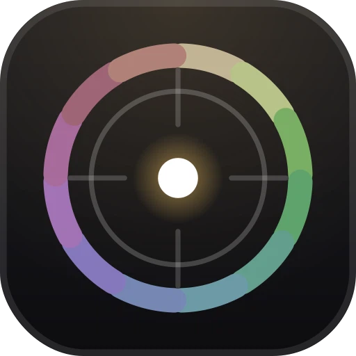

# Iris 调色盘 · Iris Palette

> 一个**单文件网页**级的专业照片编辑器，被装进了 Android / Windows / Linux / macOS / iOS 五个平台的壳里。
> 页面不依赖任何外部网络资源，所有调色、合成、导出都在你自己的设备上算完。

<p align="left">
  
</p>

- 🌐 在线直接体验：<https://david1a21.github.io/iris-palette-web/>
- 📦 全平台安装包：[Releases](../../releases)
- 📄 页面本体：`web/index.html`（约 768 KB，单个 HTML 文件，内联全部 CSS / JS / GLSL）

---

## 目录

- [它是什么](#它是什么)
- [能做什么](#能做什么)
- [五端安装](#五端安装)
- [三十秒上手](#三十秒上手)
- [技术架构](#技术架构)
- [外壳做了什么适配](#外壳做了什么适配)
- [仓库结构](#仓库结构)
- [自己构建](#自己构建)
- [常见问题](#常见问题)
- [版本与文件清单](#版本与文件清单)
- [许可与声明](#许可与声明)

---

## 它是什么

**Iris 调色盘**的核心不是「再给你一堆滤镜预设」，而是一个**调色盘式的色彩决策模型**：

传统做法是把饱和度拉高、把某个预设套上去，结果往往是"颜色更艳了，但看着脏"。Iris 走的是另一条路 —— **色相统一 + 冷暖染色 + 影调重塑 + 柔和保护**。你在一个圆盘里选一个位置，圆盘上的横轴决定冷暖走向、纵轴决定影调重塑强度、半径决定染色强度，再配合一套皮肤保护权重，让白点落在盘里任何位置都产生**明显但协调**的成片效果，而不是把皮肤染成橘红、把天空压成塑料蓝。

同时它不是一个"只能调色"的小玩具：曲线、局部蒙版、裁剪、模板、分色、光场、命令面板、导出 PNG / 视频一整套都在里面，而且**全部跑在浏览器里**，没有后端、没有账号、不上传照片。

一句话概括：

| 维度 | 说明 |
|---|---|
| 形态 | 单文件 HTML（约 768 KB），双击即用 |
| 渲染 | WebGL 实时预览 + Canvas 2D 叠加层 |
| 联网 | **零外部依赖**：没有 CDN、没有字体服务、没有统计脚本 |
| 隐私 | 图片不离开设备，localStorage / IndexedDB 只存你自己的设置 |
| 平台 | 浏览器直接跑；另有 Android / Windows / Linux / macOS / iOS 原生壳 |

---

## 能做什么

### 1) 调色盘调色（本项目的招牌）

- 圆盘取色式调色，横轴冷暖、纵轴影调、半径强度，一次拖动同时改变多个维度
- 「零位即原图」：盘心归零时严格返回原始像素，不做任何隐式偏移
- 皮肤权重保护：肤色区域自动降低染色强度，避免人脸染色失真
- 多盘叠加：主盘、分级盘、局部盘可以分层生效

### 2) 精细调整

- 曝光 / 对比 / 高光 / 阴影 / 黑白场 / 清晰度 / 纹理
- 白平衡（色温 + 色调）与 HSL 分通道
- **曲线**：RGB 综合曲线与分通道曲线，支持控制点拖动、平滑插值
- **分色 / 三色轮分级**：阴影、中间调、高光分别做色相偏移

### 3) 局部与蒙版

- 局部蒙版：涂抹式刷子，支持羽化与不透明度
- 叠加层可视化：蒙版灰度快照直接画在画面上，所见即所改
- 分区调整不影响未涂抹区域，适合天空、人物主体分开处理

### 4) 滤镜与胶片

- 内置胶片库，按年代 / 品牌 / 冷调暖调分类
- 滤镜强度可调，可与手动调整叠加
- 支持导入 `.cube` LUT 与外部的预设 JSON

### 5) 构图与元素

- 裁剪：自由比例与常见比例、旋转校正、网格辅助
- 画面元素：文字、贴纸类叠加元素，位置可拖
- 模板库：把常用的一套调整保存成模板，下次一键复用

### 6) 效率与会话

- **命令面板**：一个输入框跳所有功能，键盘党友好
- 全局快捷键：全屏看图、适应窗口、100% 缩放、对比原图等
- 自动保存 / 编辑历史 / 最近使用 / 导出记录
- 搜索与分类：滤镜库、模板库都能按关键词过滤
- 内置**使用说明书**与**技术实现（18 章，带目录与搜索）**两套独立页面

### 7) 导出

- PNG 导出（带优化：与浏览器原生 PNG 比大小，取更小的那个）
- 视频导出（源为视频时）
- 一键保存到相册（移动端）/ 落入下载目录（桌面端）

---

## 五端安装

> 所有安装包都在 [Releases](../../releases) 里。**页面内容五端完全一致**，差别只在外壳和系统集成。

### Android

| 文件 | 版本 | 说明 |
|---|---|---|
| `Iris_1.0.2.apk` | 1.0.2（versionCode 3） | 通用 arm64 包，已用 v2+v3 签名 |

- 安装时需要允许「未知来源应用」
- 首次打开会申请相册写入权限（用于导出后自动存图），拒绝也能用，只是导出走系统分享
- 已处理：WebView 内 `<a download>` 静默失败、系统文件选择器对扩展名的过滤、返回键语义

### iOS

| 文件 | 版本 | 说明 |
|---|---|---|
| `Iris-Palette-iOS-1.0.3.ipa` | 1.0.3（build 4） | **未签名**，arm64，最低 iOS 16.0 |

未签名 ipa 不能直接双击安装，两条路：

1. **自签工具**（Sideloadly / AltStore / 爱思助手）：用你自己的 Apple ID 重签后安装，7 天或 1 年有效取决于账号类型
2. **越狱设备**：TrollStore / AppSync 可直接装

已处理：导出走原生存档（规避 iOS 上 blob 下载失败）、状态栏不再遮挡二级页的返回键、屏幕左缘侧滑返回。

### Windows

| 文件 | 版本 | 说明 |
|---|---|---|
| `Iris-Palette-Windows-x64-1.0.1.zip` | 1.0.1 | 解压即用，无需安装 |

- 解压后双击 `Iris 调色盘.exe`
- 首次运行 SmartScreen 可能提示，点「更多信息 → 仍要运行」

### Linux

| 文件 | 版本 | 说明 |
|---|---|---|
| `Iris-Palette-Linux-x64-1.0.1.tar.gz` | 1.0.1 | 解压后给执行位即可 |

```bash
tar -xzf Iris-Palette-Linux-x64-1.0.1.tar.gz
chmod +x "Iris 调色盘"
./"Iris 调色盘"
```

### macOS

| 文件 | 版本 | 适用机型 |
|---|---|---|
| `Iris-Palette-macOS-arm64-1.0.1.zip` | 1.0.1 | Apple Silicon（M 系列） |
| `Iris-Palette-macOS-x64-1.0.1.zip` | 1.0.1 | Intel 芯片，**支持 macOS 10.15+，实测 macOS 12 可用** |

> ⚠️ 这两个包**不通用**。Intel 机器装 arm64 包会报「应用已损坏 / 版本要求过高」这类含糊错误 —— 那是架构不匹配，不是系统版本问题。包里附了 `启动说明.txt`。

首次打开被 Gatekeeper 拦下时：

```bash
xattr -dr com.apple.quarantine "/Applications/Iris 调色盘.app"
```

或者右键 → 打开 → 再点「打开」。

### 浏览器 / 在线

不需要安装：直接打开 `web/index.html`，或者访问在线版 <https://david1a21.github.io/iris-palette-web/>。

---

## 三十秒上手

1. 打开应用，把照片拖进窗口（或点选图器）
2. 右侧「调色盘」区域，先在盘心附近小幅拖动，找冷暖方向
3. 用「曲线」压一下高光，用「分色」给阴影一点点冷调
4. 需要只改天空？切到「局部」，涂抹天空区域再推盘
5. 满意后「导出」——PNG 会做体积优化，视频按原编码导出

内置说明书里有 20 章完整教程，比这段长得多，界面里点「说明书」就能看。

---

## 技术架构

```
┌──────────────────────────────────────────────┐
│  单文件页面 web/index.html                     │
│  ├─ CSS     内联，一套暗色 + 金色点缀的界面      │
│  ├─ JS      纯手写，无框架、无构建步骤           │
│  ├─ GLSL    WebGL 调色管线（plate / curve …）  │
│  └─ 2D      叠加层、蒙版可视化、文字元素         │
└───────────────┬──────────────────────────────┘
                │ 同一份文件，三种外壳
   ┌────────────┼─────────────┐
   ▼            ▼             ▼
Android      Electron       iOS
WebView      (Win/Lin/Mac)   WKWebView
+ shim       + shim          + shim
```

- **页面**：单文件、零依赖、离线可用；状态存 localStorage / IndexedDB
- **Android**：原生 WebView + 一个 JS 垫片（`assets/iris-shim.js`），导出改走 MediaStore
- **桌面**：Electron 31，主进程接管 `downloadBlob`，`preload` 只暴露最小接口，`contextIsolation` 开
- **iOS**：WKWebView + `iris-ios-shim.js`，导出分块（32 KB）传回原生写文件并保存到相册

为什么坚持「页面一份、外壳多份」？因为**页面是唯一的事实来源**：任何平台都不许私自改页面逻辑，平台差异一律在外壳层消化。这样升级页面时，五端只需要替换同一个 `index.html`，行为天然一致。

---

## 外壳做了什么适配

这些不是「把 HTML 塞进容器」就完事的细节，是各平台真正会翻车的地方：

**Android（`iris-shim.js`）**
- `<a download>` + `blob:` 在 WebView 里会静默失败 → 拦截点击，改走原生保存
- 系统文件选择器会按 MIME 过滤掉 `.cube` / `.heic` → 运行时放宽 `accept`
- 返回键：二级页面开着时先关页面，而不是直接退出应用
- 导出后自动写入相册（MediaStore），不依赖下载目录权限

**Electron（`main.js` / `preload.js` / `shim.js`）**
- `will-download` 接管，导出直接落到系统下载目录并给出通知
- 关掉 `nodeIntegration`，只通过 `contextBridge` 暴露必要方法
- 窗口无边框暗色、拖拽导入、双击标题栏最大化等桌面习惯

**iOS（`iris-ios-shim.js` + `ShellViewController.swift`）**
- blob 下载在 iOS 上基本不可用 → 分块转 base64 交给原生，写文件后存相册
- 二次确认闸：启动 2.5 秒内、或没有真实手势产生的 blob 一律不写相册，防止页面初始化时的临时图混进相册
- 安全区：主界面顶栏、二级页面、底部 dock 全部按 `safe-area-inset` 内缩，状态栏不再压住「‹ 返回」
- 侧滑返回：屏幕左缘右滑，优先关闭二级页面，其次走 WebView 历史
- 选择器放宽：`image/*,video/*`、`.cube`、`.json` 都不再被系统过滤

---

## 仓库结构

```
iris-palette/
├── web/
│   └── index.html                 # 页面本体（唯一源，768 KB）
├── android/
│   ├── AndroidManifest.xml
│   ├── build.sh                   # aapt2 + d8 + zipalign + apksigner
│   ├── java/                      # 原生外壳
│   ├── res/                       # 图标、主题、字符串
│   └── assets/
│       ├── index.html             # 与 web/index.html 同源
│       └── iris-shim.js           # WebView 适配层
├── desktop/
│   ├── app/
│   │   ├── main.js                # 主进程：窗口、下载接管
│   │   ├── preload.js             # 最小暴露面
│   │   ├── shim.js
│   │   ├── assets/index.html      # 与 web/index.html 同源
│   │   └── ui/                    # 应用图标等
│   ├── scripts/
│   │   ├── build.js               # 三平台打包（win / linux / mac / macx64）
│   │   └── pack_release.py        # 产出 release zip / tar.gz + checksums
│   ├── build.sh
│   └── package.json
├── ios/
│   ├── Sources/                   # Swift：AppDelegate / Shell / 分块存档
│   ├── Resources/
│   │   ├── index.html             # 与 web/index.html 同源
│   │   ├── iris-ios-shim.js
│   │   ├── Info.plist
│   │   └── Icons/
│   ├── build_ipa.sh               # 用 iphoneos SDK 直接 swiftc
│   └── .github/workflows/ios.yml  # 云端 macos runner 出包
├── docs/screenshots/              # 宣传图（界面实拍风格）
├── SHA256SUMS.txt
├── LICENSE
└── README.md
```

> 三处 `index.html` 是**同一份文件**，只是为了让各端独立构建时不必改动构建脚本。改动请先改 `web/index.html`，再同步到三个壳里。

---

## 自己构建

### Android

需要 JDK 17 与 Android SDK（build-tools 34、platform android-34）。

```bash
cd android
export JAVA_HOME=/path/to/jdk17
bash build.sh          # 注意：zip 分发的工程解压后可能丢执行位，用 bash 调起最稳
```

产物在 `dist/Iris_1.0.2.apk`。签名默认用工程里的 keystore，**开源仓库未附带私钥**，请自备 keystore 并在 `build.sh` 里改路径。

### 桌面（Electron）

需要 Node 20+，Electron 运行时会被缓存到 `.cache/`。

```bash
cd desktop
npm install
node scripts/build.js all      # win | linux | mac | macx64 | all
python3 scripts/pack_release.py
```

- `mac` 产出 arm64，`macx64` 产出 Intel 版；两者必须分开，否则 Intel 机器直接打不开
- asar 内的页面路径是 `assets/index.html`

### iOS

需要 macOS + iphoneos SDK（完整 Xcode 或 Command Line Tools）。仓库自带 GitHub Actions 工作流，推 `Sources/**` 或 `Resources/**` 就会在 `macos-15` 上自动出包。

```bash
cd ios
bash build_ipa.sh              # 未签名 ipa
bash build_ipa.sh --adhoc      # 额外 ad-hoc 签名
```

---

## 常见问题

**Q：照片会被上传到服务器吗？**
不会。页面零外部请求，处理全在本地 GPU / CPU 上；连字体都是系统字体。

**Q：为什么三端版本号不一样（1.0.2 / 1.0.1 / 1.0.3）？**
页面内容完全一致，版本号是各端自己迭代的产物：Android 改版换了签名与返回键逻辑、桌面调了打包、iOS 修了安全区与侧滑。**看到版本号不同不代表内容不同。**

**Q：macOS 装完提示「应用已损坏」或「版本要求过高」？**
九成是架构问题。Intel 机器必须用 `x64` 包，Apple Silicon 用 `arm64` 包。判断方法：`lipo -info "Iris 调色盘.app/Contents/MacOS/Iris 调色盘"`。

**Q：iOS 的 ipa 装不上？**
未签名 ipa 需要自签工具重签，或越狱环境；这是 Apple 的签名机制决定的，不是包坏了。

**Q：导出视频没反应？**
视频导出依赖源素材本身是视频；纯图片不会出现视频导出。移动端首次导出会申请相册权限。

**Q：能商用 / 二次开发吗？**
可以，MIT 许可。二次分发请保留许可与版权声明。

---

## 版本与文件清单

### 本期发布（同一份页面，五端同源）

| 平台 | 文件 | 版本 | 大小 |
|---|---|---|---|
| Android | `Iris_1.0.2.apk` | 1.0.2 · code 3 | ≈ 618 KB |
| iOS | `Iris-Palette-iOS-1.0.3.ipa` | 1.0.3 · build 4 | ≈ 678 KB |
| Windows x64 | `Iris-Palette-Windows-x64-1.0.1.zip` | 1.0.1 | ≈ 107 MB |
| Linux x64 | `Iris-Palette-Linux-x64-1.0.1.tar.gz` | 1.0.1 | ≈ 102 MB |
| macOS arm64 | `Iris-Palette-macOS-arm64-1.0.1.zip` | 1.0.1 | ≈ 93 MB |
| macOS x64 | `Iris-Palette-macOS-x64-1.0.1.zip` | 1.0.1 | ≈ 99 MB |

页面本体：`web/index.html`，**785,822 字节**，MD5 `b8e24c9d57c8c00ccf042be55c6e24e7`。

校验和见 `SHA256SUMS.txt`：

```bash
shasum -a 256 -c SHA256SUMS.txt     # macOS / Linux
```

### 更新日志

- **桌面 1.0.1**：新增 macOS Intel（x64）独立构建；三个平台统一 1.0.1；打包附 `启动说明.txt`
- **Android 1.0.2**：页面更新至新版；versionCode 3；返回键语义、相册写入链路复验
- **iOS 1.0.3**：修复状态栏遮挡二级页面返回键；新增屏幕左缘侧滑返回；页面更新至新版

---

## 许可与声明

- 代码以 **MIT License** 发布，见 [LICENSE](LICENSE)
- 页面里的示例照片来自公开图库，仅用于演示调色效果；替换为你自己的图片即可
- 本项目不含任何遥测、统计、账号体系；不收集任何用户数据
- 「Iris 调色盘」为个人项目，与任何商业公司无关

---

<p align="center">
  <sub>把复杂的色彩决策，压成一个可以拖动的圆盘。</sub>
</p>
